# Website Work

Freelance website design and development by [Sheikh Atta-ul-Haq](https://github.com/attaulhaq0).

Five client websites for technology services, creative production and immigration guidance. Each project below pairs a motion preview with selected content views and the work I contributed.

[Personal portfolio](https://attaulhaq-spatial-portfolio.vercel.app/#freelance-web-development)

| Website | Audience and purpose | Source |
| --- | --- | --- |
| [Narrcorp](https://narrcorp.com/) | Technology services & specialist talent | [narrcorp-website](https://github.com/attaulhaq0/narrcorp-website) |
| [AR TECH INC](https://artechsusa.com/) | Technology consulting & staffing | [artechsusa-website](https://github.com/attaulhaq0/artechsusa-website) |
| [Arissoft](https://arissoft.tech/) | Software & IT services | [arissoft-website](https://github.com/attaulhaq0/arissoft-website) |
| [Sira Studios](https://sirastudios.com/) | Creative production & brand content | [sira-studios-website](https://github.com/attaulhaq0/sira-studios-website) |
| [theEb1](https://theeb1.com/) | Immigration guidance & consultation | [theeb1-website](https://github.com/attaulhaq0/theeb1-website) |

<strong>Narrcorp — Technology services & specialist talent</strong>

**Purpose:** Bring consulting, engineering and staffing into one service narrative, with a direct way to start an enquiry.

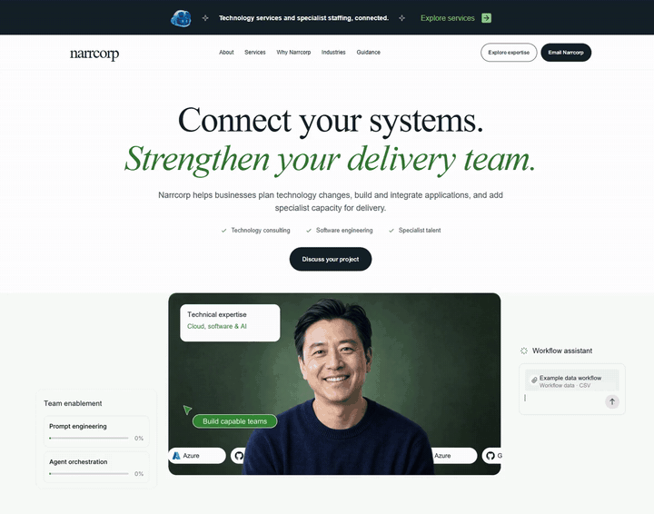

Layered hero: moving interface panels, platform badges and specialist imagery introduce the service offer.

**My contribution:** I created the service copy and visual direction, built the static Astro website and carried it through responsive QA, technical SEO and the Hostinger launch.

**Design decision:** Service cards connect each offering to a concrete task and a relevant enquiry action. The layered hero introduces the same connection between systems and specialist skills.

**Astro · TypeScript · CSS**

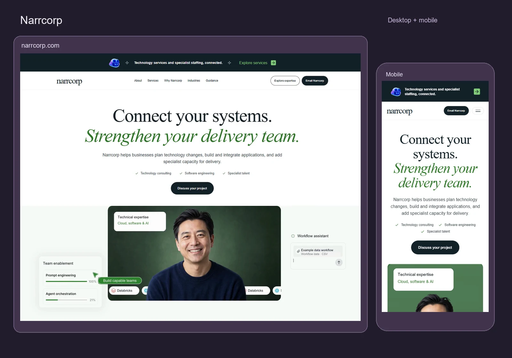

The desktop and mobile openings preserve the headline and primary action while adapting the layered composition.

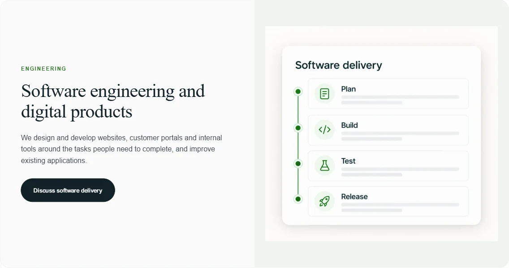

Software delivery: a complete service card pairs the work offered with its stages and a focused enquiry action.

[Live website](https://narrcorp.com/) · [Code](https://github.com/attaulhaq0/narrcorp-website) · [Build/setup guide](https://github.com/attaulhaq0/narrcorp-website/blob/main/docs/development-guide.md)

**Build scope:** Static output with canonical URLs, sitemap, structured service data and Hostinger configuration. Industry tabs, expertise carousel and native guidance disclosures; responsive and keyboard interaction checks.

Contact actions open the visitor's email application. The industry scenarios describe potential engagements, rather than completed client projects.

<strong>AR TECH INC — Technology consulting & staffing</strong>

**Purpose:** Give technology buyers and job seekers clear routes through services, industry information, staffing and careers.

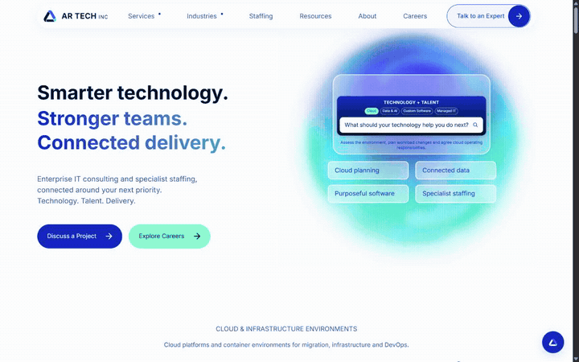

Service explorer: selecting Cloud, Data & AI, Custom Software or Managed IT changes the context and destination.

**My contribution:** I developed the service, industry, staffing and careers pages, with shared navigation, responsive layouts and PHP-backed enquiry and application interfaces.

**Design decision:** The opening service explorer changes its supporting context when a visitor chooses a discipline. Separate project and career actions serve the site's two audiences.

**HTML · CSS · JavaScript · PHP**

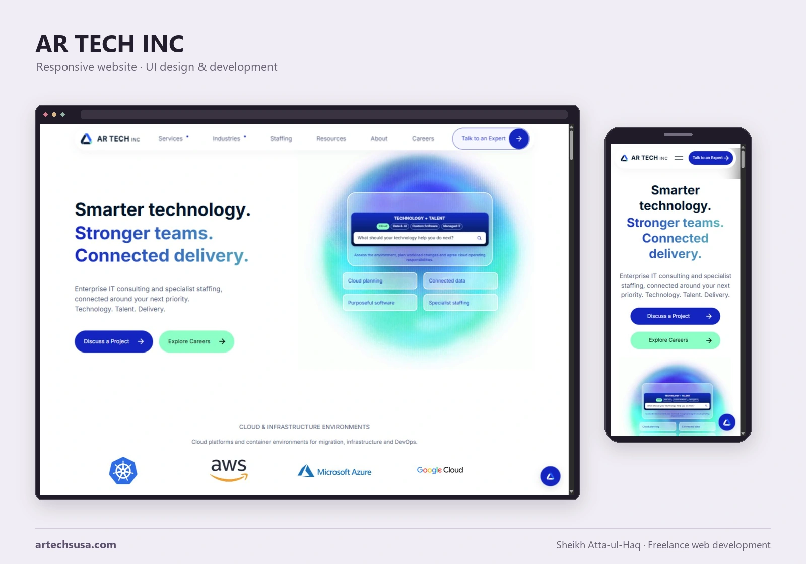

The opening pairs service exploration with separate project and career actions; mobile reorganizes the navigation.

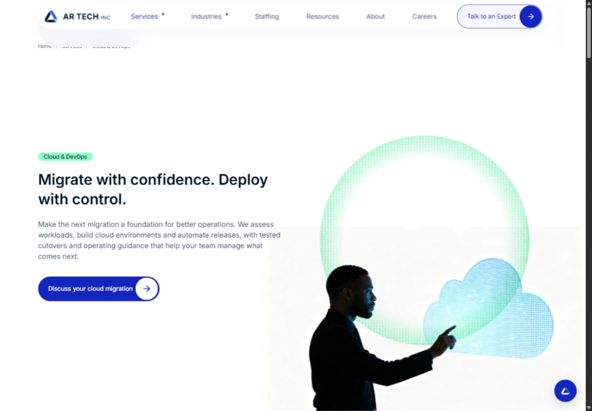

The cloud-service page gives one discipline its own explanation and contact route, beyond the homepage overview.

[Live website](https://artechsusa.com/) · [Code](https://github.com/attaulhaq0/artechsusa-website) · [Build/setup guide](https://github.com/attaulhaq0/artechsusa-website/blob/main/README.md)

**Build scope:** Shared service, industry, staffing and career routes with contact and application interfaces. Source includes canonical URLs, sitemap, JSON-LD and documented form handlers.

The source includes form handlers and local integration tests. These captures demonstrate the interface; live email and résumé delivery require the server configuration.

<strong>Arissoft — Software & IT services</strong>

**Purpose:** Present an IT company's services and industry contexts, then connect that overview to company information and contact.

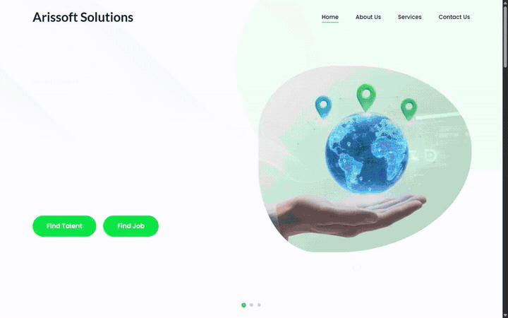

Three-slide opening: headlines, highlighted text and image masks transition together while the Find Talent and Find Job actions remain available.

**My contribution:** I built four connected pages in React and TypeScript, including the animated three-slide hero, responsive navigation and contact feedback.

**Design decision:** Three opening messages share one navigation and action pattern. Supporting pages carry the introduction into company context and detailed services.

**React · TypeScript · Vite · Tailwind CSS · PHP**

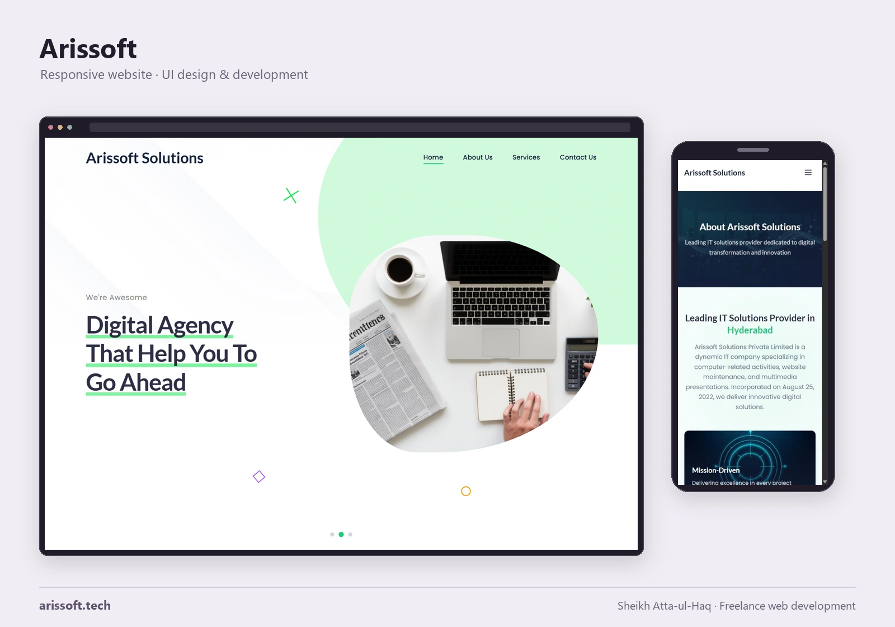

Desktop homepage and mobile About view: the opening presentation gives way to readable company information.

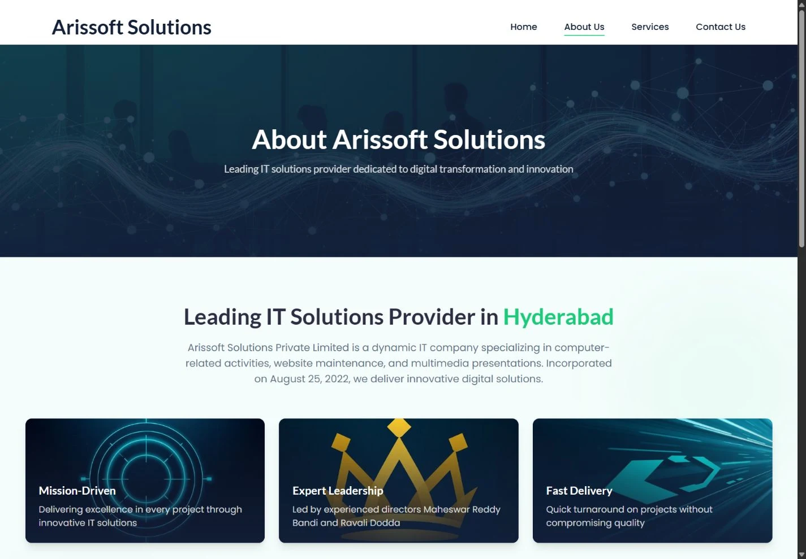

The About view places the company profile and three value cards beneath the shared navigation.

[Live website](https://arissoft.tech/) · [Code](https://github.com/attaulhaq0/arissoft-website) · [Build/setup guide](https://github.com/attaulhaq0/arissoft-website/blob/main/database/README.md)

[Complete homepage capture](https://github.com/attaulhaq0/arissoft-website/blob/main/docs/images/homepage-full.webp)

**Build scope:** Connected home, services, About and contact routes with reusable layouts. PHP content and contact endpoints, with the database setup documented in the repository.

Database-backed content and contact delivery require the documented PHP/MySQL setup. A visual preview does not establish successful message delivery.

<strong>Sira Studios — Creative production & brand content</strong>

**Purpose:** Give prospective clients, investors and job applicants distinct entry points within one studio website.

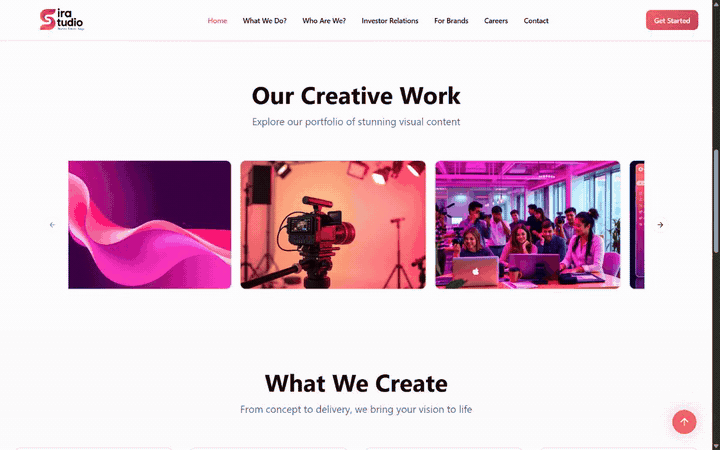

Creative-work carousel: previous and next controls move between visual content without leaving the page.

**My contribution:** I developed the studio, services, brand-work, investor and careers routes, pairing a photographic opening with a creative-work carousel and enquiry interfaces.

**Design decision:** A browsable creative-work strip establishes the studio's visual identity. Audience-specific navigation leads into more detailed services, investor and careers information.

**React · TypeScript · Vite · Tailwind CSS · PHP**

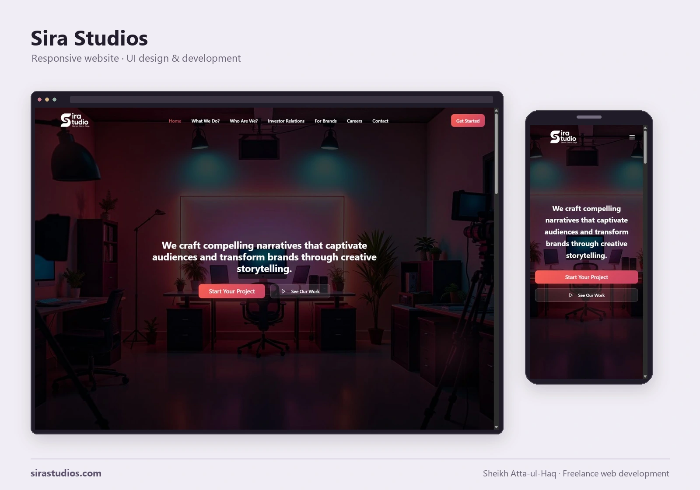

Desktop and mobile openings show how the photographic hero and primary project action adapt across screen sizes.

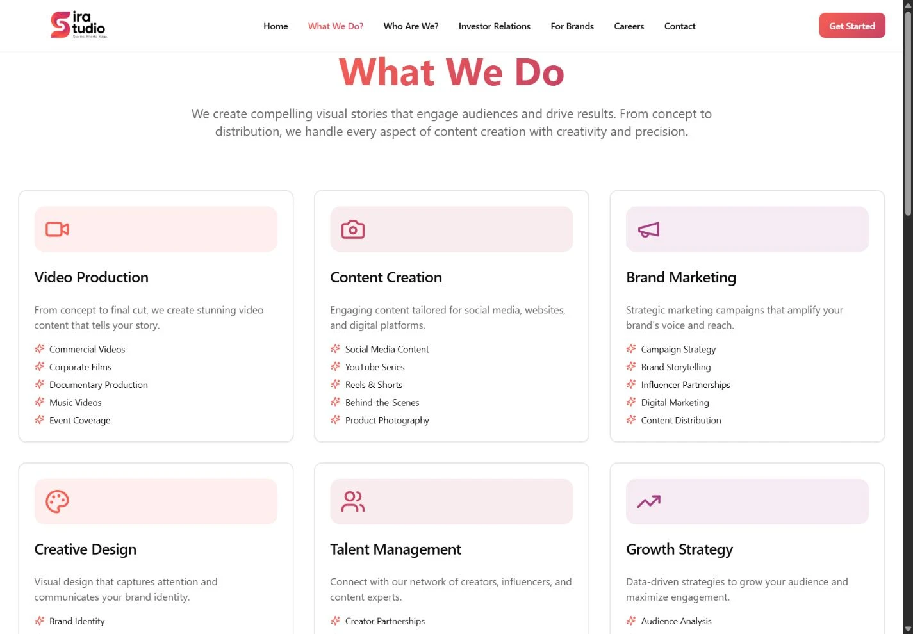

The services view groups the studio's offering into categories, giving visitors a route beyond the visual introduction.

[Live website](https://sirastudios.com/) · [Code](https://github.com/attaulhaq0/sira-studios-website) · [Build/setup guide](https://github.com/attaulhaq0/sira-studios-website/blob/main/database/README.md)

**Build scope:** Seven public routes support studio, services, brands, investors, careers and contact journeys. The source includes enquiry, application and account APIs with documented server setup.

The captures show public pages. Private account records and submitted enquiries are excluded from this showcase.

<strong>theEb1 — Immigration guidance & consultation</strong>

**Purpose:** Organize EB-1A, EB-2 NIW and O-1A service information so visitors can explore a relevant route before making a consultation enquiry.

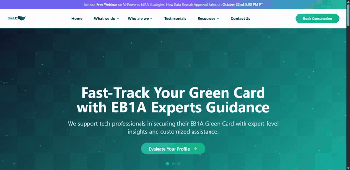

Rotating service headline: the opening moves through EB1A, O1A and EB2-NIW messages above the enquiry action.

**My contribution:** I built visa-service, FAQ, company and consultation pages using reusable content sections, animated headings and responsive navigation.

**Design decision:** The rotating opening introduces separate visa routes, while dedicated service and FAQ pages accommodate the detail needed before an enquiry.

**React · TypeScript · Vite · Tailwind CSS · PHP**

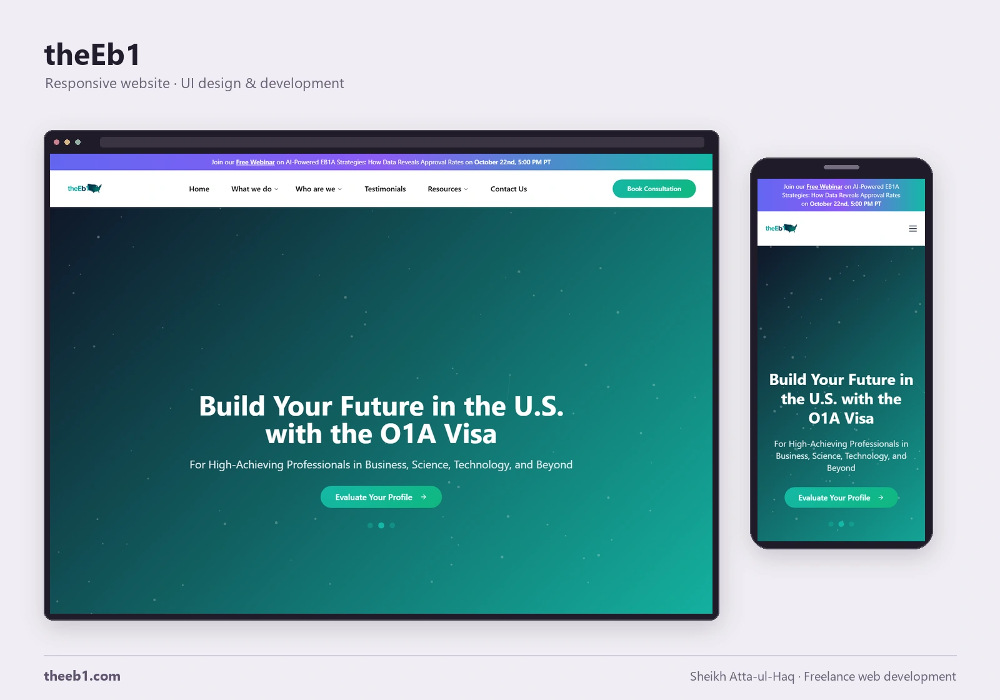

Desktop and mobile openings keep the service introduction and profile-evaluation action visible at each size.

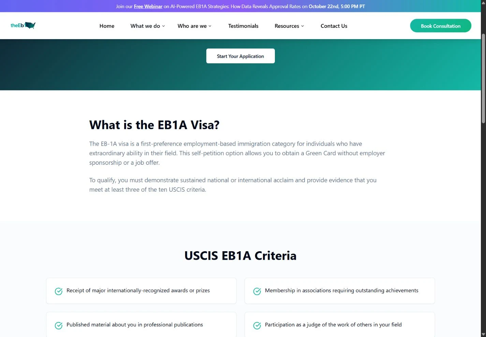

The EB-1A view separates the visa definition from a scannable criteria list, with consultation access in the shared navigation.

[Live website](https://theeb1.com/) · [Code](https://github.com/attaulhaq0/theeb1-website) · [Build/setup guide](https://github.com/attaulhaq0/theeb1-website/blob/main/database/README.md)

[Complete homepage capture](https://github.com/attaulhaq0/theeb1-website/blob/main/docs/images/homepage-full.webp)

**Build scope:** Twelve public routes include visa information, FAQs, company content and consultation. Reusable interface sections and PHP content/form endpoints are included in the source.

Local review uses fallback content and simulated form success. Production enquiries require the PHP integration; published client claims are not measured outcomes of my website work.

