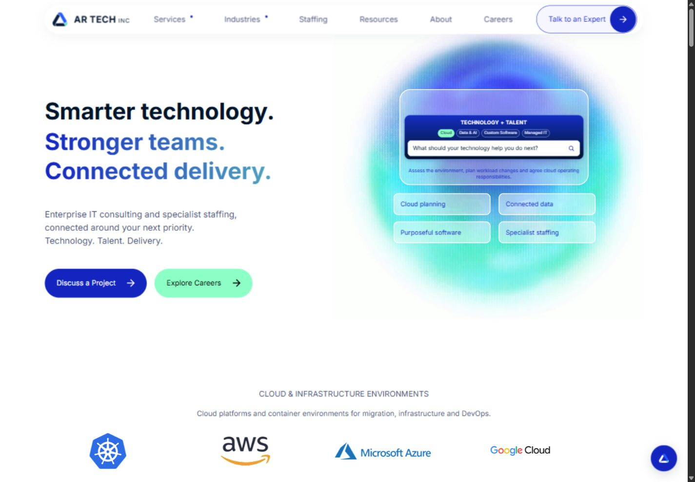
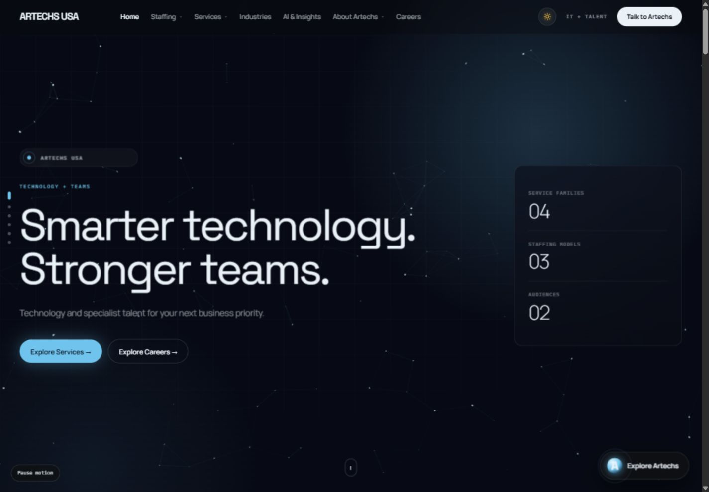

# Website Work

Website design and development by [Sheikh Atta-ul-Haq](https://github.com/attaulhaq0).

Delivered client work and frontend design previews, with source code, screenshots and live links.

| Project | Status | Stack | Links |
| --- | --- | --- | --- |
| AR TECH INC | Delivered | HTML · CSS · JavaScript · PHP | [Live](https://artechsusa.com/) · [Code](https://github.com/attaulhaq0/artechsusa-website) |
| Artechs USA — Design Lab | Design previews | React · Vite · HTML · CSS · JavaScript | [Explore](https://artechs-usa-client-review.vercel.app/) · [Code](https://github.com/attaulhaq0/artechsusa-design-lab) |

<strong>AR TECH INC — delivered website</strong>

Responsive service, industry and career pages, interactive delivery graphics, contact and application forms, and technical SEO.

- 27 routes with shared navigation and page styles.
- PHP form handling with validation, signed tokens, rate limits, SMTP/TLS and résumé attachments.
- Unique metadata, canonical URLs, structured data and 24 indexable sitemap URLs.
- Five site checks and sixteen form integration tests, with GitHub Actions verification.

[Live website](https://artechsusa.com/) · [Source and setup](https://github.com/attaulhaq0/artechsusa-website) · [Technical SEO](https://github.com/attaulhaq0/artechsusa-website/blob/main/docs/seo.md) · [Pull requests](https://github.com/attaulhaq0/artechsusa-website/pulls?q=is%3Apr+is%3Amerged)

<strong>Signal — design preview</strong>

Blue and mint direction with connected technology graphics, motion and responsive service journeys. Includes 24 preview pages.

[Explore Signal](https://artechs-usa-client-review.vercel.app/?design=signal) · [Source](https://github.com/attaulhaq0/artechsusa-design-lab/tree/main/public/replicas/signal)

<strong>Human — design preview</strong>

Editorial typography, people-focused layouts and candidate journeys. Includes 25 preview pages.

[Explore Human](https://artechs-usa-client-review.vercel.app/?design=human) · [Source](https://github.com/attaulhaq0/artechsusa-design-lab/tree/main/public/replicas/human)

<strong>Atlas — design preview</strong>

Enterprise navigation, dark and light presentation, and interactive service content. Includes 31 preview pages.

[Explore Atlas](https://artechs-usa-client-review.vercel.app/?design=atlas) · [Source](https://github.com/attaulhaq0/artechsusa-design-lab/tree/main/public/replicas/atlas)

The three design directions belong to one client project. The React review interface supports direction selection, page navigation and motion preferences. Preview forms do not send submissions.

