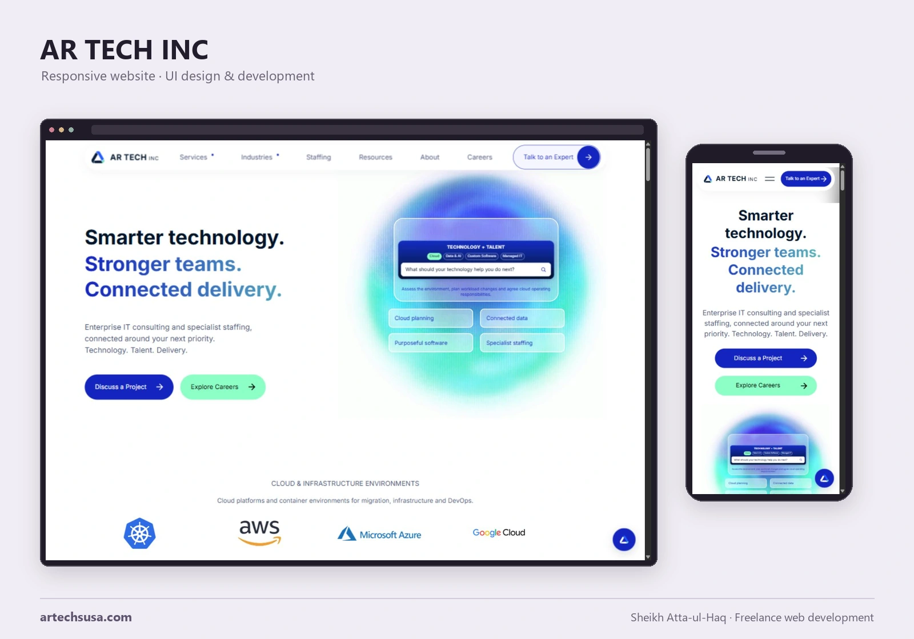
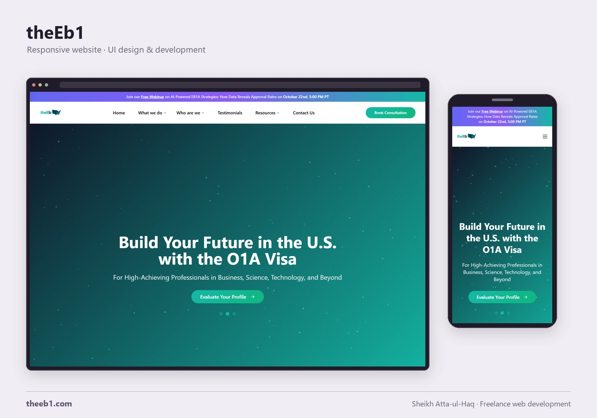

# Website Work

Freelance web development by [Sheikh Atta-ul-Haq](https://github.com/attaulhaq0).

Responsive websites with delivered source, design evidence, local setup instructions and reviewed pull requests. Each website keeps its code and design in one repository.

[View the portfolio](https://attaulhaq-spatial-portfolio.vercel.app/#freelance-web-development)

| Website | Focus | Code and design |
| --- | --- | --- |
| [AR TECH INC](https://artechsusa.com/) | Technology consulting and staffing | [artechsusa-website](https://github.com/attaulhaq0/artechsusa-website) |
| [Arissoft](https://arissoft.tech/) | Software and IT services | [arissoft-website](https://github.com/attaulhaq0/arissoft-website) |
| [Sira Studios](https://sirastudios.com/) | Creative studio and brand services | [sira-studios-website](https://github.com/attaulhaq0/sira-studios-website) |
| [theEb1](https://theeb1.com/) | Immigration services and consultation journeys | [theeb1-website](https://github.com/attaulhaq0/theeb1-website) |

<strong>AR TECH INC</strong>

Responsive service, industry and career pages across 27 routes; interactive delivery graphics; PHP contact and application forms. Technical SEO includes unique metadata, canonical URLs, JSON-LD and 24 indexable sitemap URLs.

The same repository includes the **Signal, Human and Atlas** design directions, their source and review interface.

[Live website](https://artechsusa.com/) · [Source and setup](https://github.com/attaulhaq0/artechsusa-website) · [Design previews](https://github.com/attaulhaq0/artechsusa-website/tree/main/design-previews) · [Technical SEO](https://github.com/attaulhaq0/artechsusa-website/blob/main/docs/seo.md) · [Reviewed changes](https://github.com/attaulhaq0/artechsusa-website/pulls?q=is%3Apr+is%3Amerged)

<strong>Arissoft</strong>

Responsive IT-services website with animated hero imagery, reusable service sections, industry content and enquiry forms. React, TypeScript, Vite, Tailwind CSS and PHP/PDO.

[Live website](https://arissoft.tech/) · [Source and setup](https://github.com/attaulhaq0/arissoft-website) · [Design notes](https://github.com/attaulhaq0/arissoft-website/blob/main/docs/design-notes.md) · [Complete landing page](https://github.com/attaulhaq0/arissoft-website/blob/main/docs/images/homepage-full.webp) · [Reviewed changes](https://github.com/attaulhaq0/arissoft-website/pulls?q=is%3Apr+is%3Amerged)

<strong>Sira Studios</strong>

Creative-studio website with seven public routes, brand and career journeys, responsive navigation and PHP enquiry, careers and account/admin APIs. Shared server-side login quotas and offline regression checks accompany the published source.

[Live website](https://sirastudios.com/) · [Source and setup](https://github.com/attaulhaq0/sira-studios-website) · [Design notes](https://github.com/attaulhaq0/sira-studios-website/blob/main/docs/design-notes.md) · [Reviewed changes](https://github.com/attaulhaq0/sira-studios-website/pulls?q=is%3Apr+is%3Amerged)

<strong>theEb1</strong>

Twelve public routes covering visa services, company information, testimonials, resources and consultation. Responsive React interface with animated service messages and PHP content/form endpoints; local review uses fallback content and simulated submissions.

[Live website](https://theeb1.com/) · [Source and setup](https://github.com/attaulhaq0/theeb1-website) · [Design notes](https://github.com/attaulhaq0/theeb1-website/blob/main/docs/design-notes.md) · [Complete landing page](https://github.com/attaulhaq0/theeb1-website/blob/main/docs/images/homepage-full.webp) · [Reviewed changes](https://github.com/attaulhaq0/theeb1-website/pulls?q=is%3Apr+is%3Amerged)

